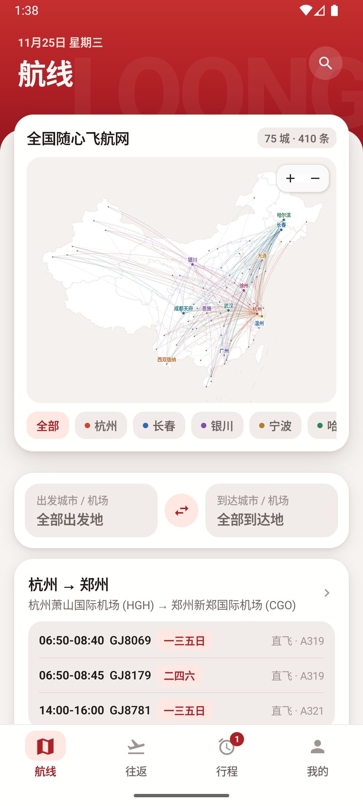
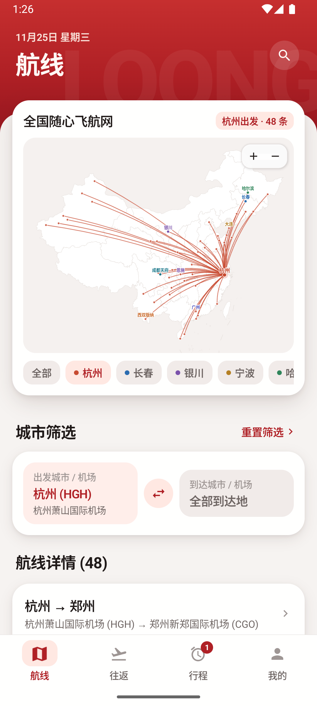
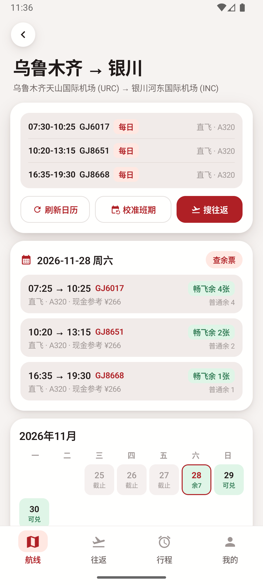
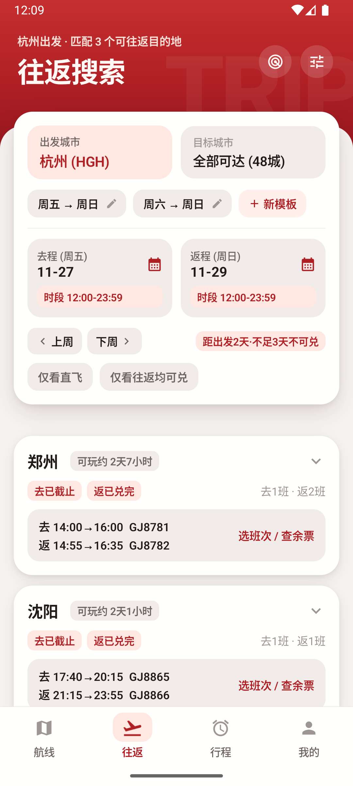
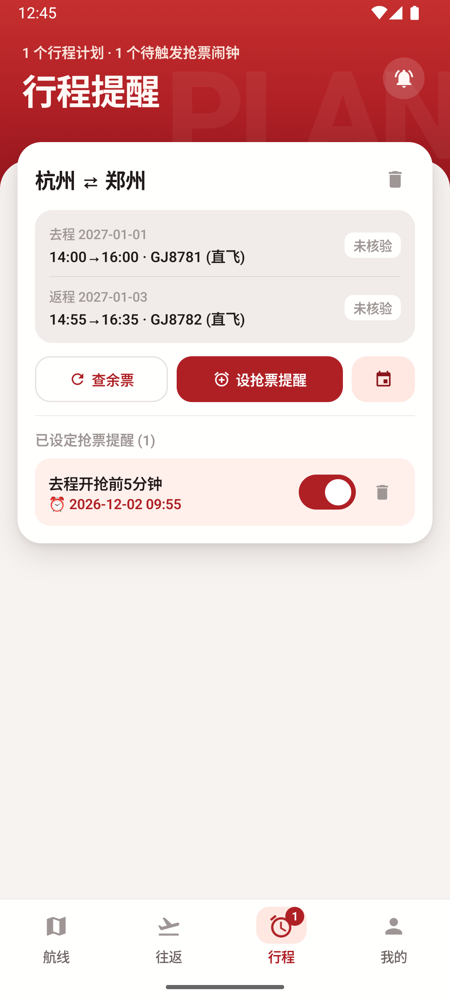
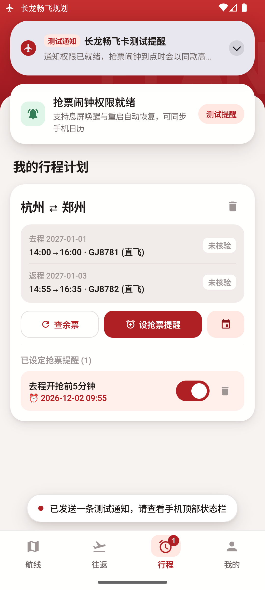

# 畅飞行 · 随心飞航网与智能往返规划助手 (Android)

[](https://github.com/ixzki/LoongAir-Trip-Planner/releases/latest)
[](https://kotlinlang.org/)
[](https://developer.android.com/compose)
[-3DDC84?logo=android&logoColor=white)](https://developer.android.com/)
[](LICENSE)

> 一款专为畅飞卡旅客打造的**纯本地、零抓包、数据私有、高颜值随心飞航网探索与智能往返决策 Android 客户端**。  
> 支持**官方手机号短信验证码直登**（内嵌网易易盾滑块，免抓包、免系统代理），内置 **75 城 · 410 条全国直飞畅飞卡基准航网**，涵盖**官方适用日期窗口核验**、**近 40 天放票日历与多舱位余票实查**、**多星期智能往返配对**、**精确抢票闹钟**与**双主题设计语言**。  
> **GitHub 仓库**：[https://github.com/ixzki/LoongAir-Trip-Planner](https://github.com/ixzki/LoongAir-Trip-Planner)  
> **最新 Release 下载**：[https://github.com/ixzki/LoongAir-Trip-Planner/releases/latest](https://github.com/ixzki/LoongAir-Trip-Planner/releases/latest)

---

## 📱 界面预览

<table>
  <tr>
    <td align="center" width="33%">
      
      <br /><sub><b>全国航网地图 & 枢纽排名</b></sub>
    </td>
    <td align="center" width="33%">
      
      <br /><sub><b>单枢纽放射聚焦视图</b></sub>
    </td>
    <td align="center" width="33%">
      
      <br /><sub><b>近 40 天日历 & 多舱余票</b></sub>
    </td>
  </tr>
  <tr>
    <td align="center" width="33%">
      
      <br /><sub><b>智能往返配对与窗口校验</b></sub>
    </td>
    <td align="center" width="33%">
      
      <br /><sub><b>行程计划 & 抢票闹钟</b></sub>
    </td>
    <td align="center" width="33%">
      
      <br /><sub><b>朱砂 / 薄暮主题化通知</b></sub>
    </td>
  </tr>
</table>

---

## ⚡ 极速上手：下载 Release 安装包

前往 GitHub Releases 页面下载已混淆压缩的正式版安装包（仅约 `2 MB`，支持 Android 8.0 及以上设备）：

👉 **[前往 Releases 下载 ChangfeiXing-v1.8.1-release.apk](https://github.com/ixzki/LoongAir-Trip-Planner/releases/latest)**

1. 下载并安装 **`ChangfeiXing-v1.8.1-release.apk`**；
2. 安装即内置全网 **75 城 · 410 条畅飞卡航线与 445 条班次时刻**，冷启动全屏动画结束后即可直接浏览全国航网与试算往返；
3. 前往「**我的**」→「**登录**」，输入手机号并通过内置网易易盾拼图滑块完成短信验证，即可自动识别名下畅飞卡、同步常驻城市实时放票日历与余票。

---

## 🌟 核心功能与架构亮点

- **🗺️ 全国随心飞交互地图与智能排布**
  - 收录全国 **75 座通航城市、410 条对称畅飞卡航线与 445 条定期航班时刻**，支持单指/双指缩放与拖拽漫游；
  - **去重弧线 + 地名防重叠**：概览模式对双向航线去重并用轻盈二次贝塞尔弧线绘制，结合实时屏幕边界碰撞检测按枢纽重要性标注城市，告别东部与川渝地名堆叠；
  - **枢纽规模排序 + 常驻优先**：地图下方枢纽胶囊按**通航目的地数量**从高到低排名（`杭州`、`长春`、`银川`、`宁波`、`哈尔滨`……），航线列表自动优先置顶当前**常驻出发城市**的出入港航线；
  - **多机场城市独立消歧**：精准区分并映射 `成都天府 (TFU)` / `成都双流 (CTU)`、`北京首都 (PEK)` / `北京大兴 (PKX)`、`上海浦东 (PVG)` / `上海虹桥 (SHA)`、`遵义新舟 (ZYI)` / `遵义茅台 (WMT)`。

- **🧭 内置基准航网 + 失效航线全生命周期管理**
  - 区分内置基准（`bundled`）与实时校验（`official`）来源，并维护失效航线墓碑表（`invalidated_routes`）；
  - **严格区分约满与失效**：当某航线仍在卡内适用范围、仅近期放票名额全部约满（`status == 0`）时，完整保留于有效航网中供每日 10:00 或退票回流蹲守；仅当官方明确返回停航无班（全期 `-4`）或本卡不适用（窗口内全 `-2` / 权限拒访）时，才自动永久剔除失效航线；
  - 随时可在「设置」一键恢复内置航线库，或在「畅飞航网管理」查看并重检被剔除航线。

- **📅 2026–2027 官方适用日期核验 & 近 40 天余票日历**
  - 内置 2026–2027 年畅飞卡 5 段官方适用日期窗口及 125 个春运 / 五一 / 暑运 / 中秋国庆屏蔽日历（自动标记 `不可用` 并阻止在全局屏蔽期间误删有效航线）；
  - 全链路统一校验 **起飞前 3 天 23:40 兑换截止线**：无论在月历详情、往返搜索结果卡片还是已保存行程中，3 天内日期一律正确归一化标注为 `已截止`；
  - 点击航线进入 **近 40 天月历详情页**，支持单日实时查多舱位聚合的**畅飞卡剩余张数**、普通余票与现金参考价，以及 `一三五日` / `二四六` 双模式 + 7 天全周期班期校准。

- **🔍 多星期 / 任意日智能往返配对**
  - 自定义往返模板支持单选星期、多选出发星期几或「**任意日**」组合，自由限定去程/返程起飞时段与「仅看直飞 / 仅看往返均可兑」，自动估算目的地可停留时长；
  - 内置防风控节流与可中断恢复的**批量日历核验**雷达扫描。

- **⏰ 精确抢票闹钟与主题化通知卡片**
  - 选定去返航班加入「行程」，自动按 **北京时间（`Asia/Shanghai`）** 推算提前 30 天 `09:55` 开抢提醒、前 4 天 `20:00` 兑换截止前提醒及次日早 `09:55` 回流票提醒；
  - 基于 `AlarmManager.setExactAndAllowWhileIdle` 实现息屏精确唤醒，监听开机、升级及系统时间/时区变化自动重建闹钟，并支持一键写入手机系统日历；
  - 自定义通知横幅与展开卡片跟随「**朱砂 / 薄暮**」主题与深浅色系统外观实时变色。

- **🎨 双主题视觉与启动体验**
  - 完整适配「**朱砂**」（暖宣纸底 + 三段朱漆渐层）与「**薄暮**」（雾白纸面 + 蓝紫柔光）双主题，搭配全屏轨迹动画启动页与简洁的居中爬升客机自适应图标。

---

## 🛡️ 纯本地与安全原则 (Local-First & Privacy-First)

1. **零第三方云端上传**：所有会话 Token、`scgTid`、手机号、证件信息、日历缓存与行程计划 **100% 仅保存在手机本地**，无任何中转服务器或第三方埋点遥测；
2. **硬件级加密隔离**：敏感凭据经由 `AndroidKeyStore` 硬件级 **AES-256-GCM** 加密保存于 `SharedPreferences`，并关闭系统自动云备份与设备迁移导出；
3. **直连防风控保护**：内置全局网关限流器（`ApiRateLimiter`）与 Token 自动续期互斥锁（`Mutex`），避免高频并发触发账号或接口限制。

---

## 💻 开发者指南：本地编译与测试

### 环境要求
- **JDK 17**（推荐 Eclipse Temurin 17）
- **Android SDK**（`compileSdk = 35`、`minSdk = 26`）

### 构建与验证命令

```powershell
$env:JAVA_HOME = "C:\Program Files\Eclipse Adoptium\jdk-17.0.21.10002-hotspot"
$env:ANDROID_HOME = "$env:LOCALAPPDATA\Android\Sdk"

# 运行全部单元测试、Lint 静态检查并构建 Debug 与 R8 压缩版 Release APK
.\gradlew.bat testDebugUnitTest lintDebug assembleDebug assembleRelease
```

输出 APK 路径：
- Release APK（已开启 R8 混淆与资源压缩）：`app/build/outputs/apk/release/ChangfeiXing-v1.8.1-release.apk`
- Debug APK：`app/build/outputs/apk/debug/ChangfeiXing-v1.8.1-debug.apk`

---

## 📁 项目目录结构

```text
LoongAir-Trip-Planner/
├── .github/workflows/
│   └── build-apk.yml                    # CI 自动测试、Lint 及 Tag Release 发布工作流
├── docs/
│   ├── RELEASE_NOTES.md                 # GitHub Release 发布说明
│   └── screenshots/                     # 实机界面预览截图
├── app/
│   ├── build.gradle.kts                 # 应用构建配置与自动化版本 APK 命名
│   ├── schemas/                         # Room 数据库迁移 Schema (v4 - v6)
│   └── src/
│       ├── main/
│       │   ├── assets/
│       │   │   ├── bundled_changfei_network.json  # 内置 75 城 410 条航线基准库
│       │   │   ├── china_provinces.json           # 中国省级矢量地理轮廓
│       │   │   └── yidun_captcha.html             # 本地网易易盾滑块校验容器
│       │   ├── java/com/loongair/tripplanner/
│       │   │   ├── MainActivity.kt                # 单 Activity 入口与边到边架构
│       │   │   ├── MainViewModel.kt               # 全网状态管理与协程调度
│       │   │   ├── alarm/                         # 精确闹钟调度、开机恢复与主题化通知
│       │   │   ├── data/
│       │   │   │   ├── local/                     # Room 数据库、DAO、AES-256-GCM 凭据加密
│       │   │   │   ├── remote/                    # 官方网关客户端、航班号解码、双机场映射与限流器
│       │   │   │   └── repository/                # 航网同步生命周期、2026-2027 窗口规则与往返配对引擎
│       │   │   └── ui/
│       │   │       ├── routes/                    # 全国航网地图、枢纽排行与近 40 天日历详情页
│       │   │       ├── search/                    # 多星期/任意日往返搜索与选日校验弹窗
│       │   │       ├── plans/                     # 行程计划卡片、系统日历导出与闹钟管理
│       │   │       ├── account/                   # 短信登录、多卡切换、常驻城设置与关于页
│       │   │       ├── components/                # 全屏启动页、质感卡片、滚轮折叠头图等通用组件
│       │   │       └── theme/                     # 朱砂 / 薄暮双主题色板、字阶与弹簧物理动效
│       │   └── res/                               # 自适应图标、主题化通知 RemoteViews 布局与色值
│       └── test/                                  # 单元测试 (加解密、解码器、往返配对、窗口校验与通知清洗)
├── LICENSE                                        # MIT 开源协议
└── README.md                                      # 项目完整文档
```

---

## 📄 开源致谢、协议与免责声明

### 🙏 开源致谢
- 官方网关交互逻辑与航班号解码参考开源项目 [eureka-wu/clairline](https://github.com/eureka-wu/clairline)（MIT License）；
- 双主题色阶、字阶规范、物理弹簧动效与卡片视觉体系致敬开源项目 [zzNaLogiczz/chher-public](https://github.com/zzNaLogiczz/chher-public)。

### ⚖️ 开源协议
本项目基于 [MIT License](LICENSE) 开源。

### ⚠️ 免责与合规声明
1. **非官方声明**：本项目为个人开源学习与出行规划工具，**与浙江长龙航空有限公司无任何官方关联或商业合作**；相关商标及服务权益均归长龙航空官方所有。
2. **仅限自用与研究**：严禁将本项目及其编译产物用于任何商业牟利、付费代抢/代查等违规用途。
3. **以官方数据为准**：航线范围、可兑名额、适用日期及航班时刻请 100% 以长龙航空官方 App、微信小程序及官网为准；因高频查询或不当操作引起的账号风控与相关风险由使用者自行承担。
